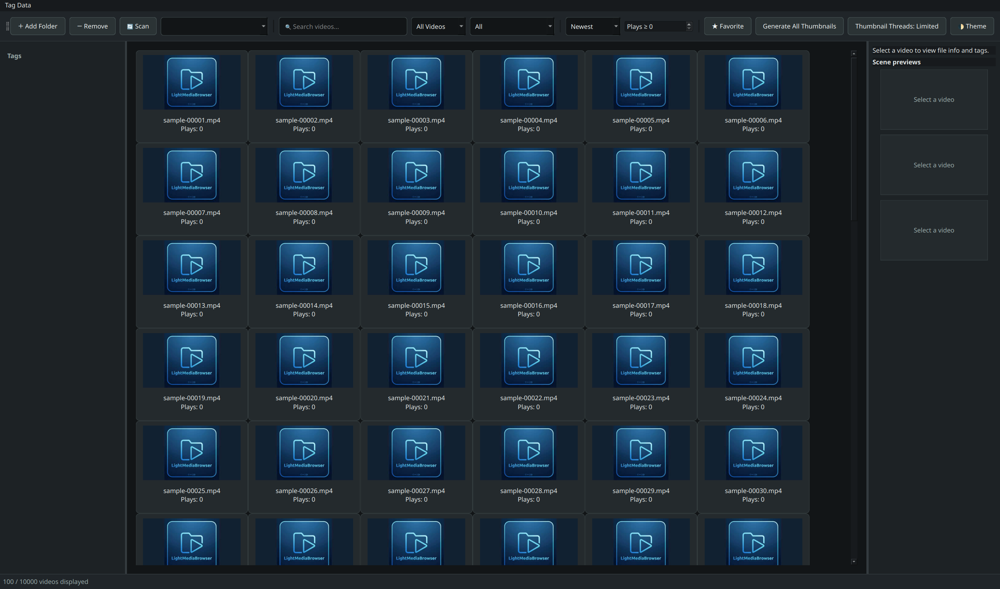

# LightMediaBrowser

[English](README.md) | [日本語](README.jp.md)

**Bring videos scattered across folders and drives into one fast, lightweight local library — without uploading them to the cloud or moving the original files.**



It is designed specifically for **video management** — scanning, browsing, searching, tagging, and organizing your collection.

**It is not a video player.** Play your files with the external player you prefer, such as VLC, mpv, or MPC-HC/BE.

> **Status: 0.0.17**
>
> This release is under active development. The core workflow is usable, but features and internal architecture may change.

---

## Why LightMediaBrowser?

When a large video collection is spread across internal and external drives, finding the right file can mean searching through folders one by one.

LightMediaBrowser brings multiple local folders into one searchable library. Your videos stay where they are, while you can:

* Scan multiple local folders
* Browse videos in a thumbnail-based library
* View three large, evenly spaced scene previews for the selected video
* Search and filter your collection
* Organize videos with tags
* View video metadata
* Mark favorites and track playback counts
* Open videos with your preferred external player

The application focuses on **managing your video collection**, rather than trying to replace your video player.

---

## Features

### Local Video Library

* Add and manage multiple folders
* Recursively scan folders for video files
* Browse videos in a thumbnail-based library
* Original video files are never modified by the application

### Fast Browsing

* Scan folders in the background while keeping the library responsive
* Load video entries incrementally as you browse instead of loading the entire collection at once
* Generate thumbnails only for videos in the visible list area
* Read detailed media metadata when you select a video, in the background, and cache it in the local database for later
* Generate missing thumbnails for all registered videos from the toolbar, with progress and cancellation in the status bar while keeping the rest of the app usable
* Bulk thumbnail generation uses a bounded two-worker queue and skips valid cached thumbnails
* Thumbnail caching
* Additional scene previews are generated only for the selected video and cached for later
* Database-backed library
* These on-demand workflows help keep browsing responsive and avoid unnecessary work across large collections

### Performance snapshot

The following measurements were recorded on 2026-11-26 with LightMediaBrowser 0.0.17 (Release), Qt 6.10.2, and SQLite 3.46.1 on Ubuntu 26.04, Linux 7.0.0-44, an AMD Ryzen 7 7735HS (16 logical CPUs), and 31.6 GB RAM.

| Videos in database | Rows added in this step | Filename search (1 match) | Search count | Unfiltered 100-item page |
| ---: | ---: | ---: | ---: | ---: |
| 100 | 100 | 0.084 ms | 0.034 ms | 0.136 ms |
| 1,000 | 900 | 0.168 ms | 0.124 ms | 0.820 ms |
| 10,000 | 9,000 | 1.023 ms | 1.002 ms | 7.885 ms |

The actual folder scanner found all 10,000 files in 84 ms. Search and count figures are medians of 21 measured calls after a warm-up, using the application's `searchVideosLight` and `countVideosLight` database methods. Each filename query matched one item; the page query loaded up to 100 items.

| Startup scenario | Window visible | Peak process RSS |
| --- | ---: | ---: |
| First launch with a new, empty database | 161 ms | 148 MiB |
| Empty database relaunch (5 runs, median) | 163 ms | 146 MiB median |
| 10,000-video database (5 runs, median) | 163 ms | 161 MiB median; 171 MiB maximum |

Startup time is measured from process launch until the application window is visible under X11/XWayland. RSS is the Linux process high-water mark, read two seconds after the window appears; it excludes child processes such as FFmpeg. The OS file cache was not cleared between runs.

The dataset consists of one generated, one-second 640x360 MP4 based on the application icon, hard-linked under 10,000 unique names in 100 directories. It exercises file enumeration and database scaling, but does not represent 10,000 distinct video contents, codecs, or thumbnail decoding. Search uses the current filename/notes substring query with a single matching filename; these local results are not guarantees for other hardware or query patterns.

See [the benchmark guide](benchmarks/README.md) to reproduce the measurements. Generated media and per-run databases stay under the ignored `benchmarks/generated/` directory.

### Search & Filtering

* Search your video library
* Filter videos
* Find videos by filename and other stored information
* Filter by favorites, playback count, and tags
* Find video candidates with a matching file size or filename

A matching file size or filename does not confirm that video contents are identical.

### Tags & Organization

* Create tag categories
* Assign tags to videos
* Use tags and notes to organize large collections
* Mark videos as favorites
* Export and import tag categories, video tag assignments, and notes as JSON from the **Tag Data** menu

Imports merge tag definitions and update notes and tag assignments only for videos whose file paths match exactly. Unmatched videos are skipped. Export files can contain local file paths and notes; the default `LightMediaBrowser-tag-data*.json` filenames are ignored by Git.

The JSON contains `categories` entries with a `name` and `tags` list, plus `videos` entries with `path`, `fileName`, `fileSize`, `note`, and tag objects containing `category` and `name`. Keep each video `path` unchanged when importing edited data.

### Video Metadata

LightMediaBrowser retrieves and displays information such as:

* Duration
* Resolution
* Video and audio codecs
* Other available media metadata

### External Video Players

LightMediaBrowser intentionally does **not** include a built-in video player.

When you want to watch a video, the application opens it using the video player associated with your operating system.

This keeps LightMediaBrowser focused on its main purpose:

> **Organize your videos. Use the player you already like.**

---

## Local-first & Non-destructive

LightMediaBrowser is designed to manage media stored locally. Library information is stored separately in a SQLite database, and your original video files remain in place.

It does **not**:

* Upload your videos to a cloud service
* Require an online account
* Modify your original video files
* Convert your videos
* Replace your existing video player

Your media files remain yours.

---

## Data Storage

Library information is stored in a SQLite database, and application preferences use Qt's standard settings system.

Use **Thumbnail Threads: Limited / Unlimited** in the toolbar to toggle the parallel thread limit for thumbnail generation. The limit is enabled by default to reduce CPU load. The button label shows the active setting, and your preference is restored the next time you launch the application.

On Linux, the default locations are:

```text
~/.local/share/LightMediaBrowser/database.sqlite
~/.config/LightMediaBrowser/LightMediaBrowser.conf
```

Application diagnostics are written to `lightmediabrowser.log` in Qt's application-data location, with 5 MB rotation and three backups. The log is kept locally and does not contain media payloads or database records.

At startup, LightMediaBrowser checks for `ffmpeg` and `ffprobe`. If either tool is missing, it shows a status-bar hint with platform-specific installation guidance.

The SQLite schema migrates automatically within the supported version range. A database created by a newer unsupported application version is left unopened with a clear error instead of being modified.

### About deleted or moved files

The library database is separate from the filesystem.

After a complete scan of an available registered folder, records and thumbnails for video files no longer found in that folder are deleted. If any part of a scan is unavailable or unreadable, missing-file cleanup is skipped to avoid deleting records based on incomplete results. If a registered folder itself is unavailable, its records and thumbnails are kept in case an external drive has only been temporarily disconnected.

---

## Project Status

**Current version: 0.0.17**

LightMediaBrowser is in early development.

The core video-management workflow is implemented:

```text
Add folder
    ↓
Scan videos
    ↓
Generate thumbnails
    ↓
Browse library
    ↓
Search / Filter
    ↓
Tag / Organize
    ↓
Open with your preferred player
```

The 0.0.x releases are intended to validate the application's basic design and workflow. Changes may include:

* Bugs and missing features
* UI changes
* Database schema, API, and internal architecture changes

Feedback and bug reports are welcome.

---

## What LightMediaBrowser is Not

LightMediaBrowser is not intended to be an all-in-one media application.

It is not intended to be:

* A video player
* A video editor or converter
* A media streaming server
* A cloud media service

Its purpose is simple: **manage and browse your local video collection quickly.**

---

## Tech Stack

* **Language:** C++20
* **Framework:** Qt 6

  * Qt Core
  * Qt GUI
  * Qt Widgets
  * Qt SQL
  * Qt Concurrent
  * Qt Network
* **Database:** SQLite 3
* **Build system:** CMake 3.21+
* **Media processing:** FFmpeg command-line tools (`ffmpeg` and `ffprobe`)

---

## Requirements

To build and run LightMediaBrowser, you need:

* CMake 3.21 or later
* A C++20-compatible compiler such as GCC or Clang
* Qt 6 development packages, including Qt SQL and the QSQLITE driver
* `ffmpeg` and `ffprobe` command-line tools at runtime

### Ubuntu / Debian

```bash
sudo apt update

sudo apt install \
  build-essential \
  cmake \
  qt6-base-dev \
  ffmpeg
```

---

## Windows, macOS, and Linux Downloads

Download these packages from a GitHub Release created from a `v*` tag:

* **Windows 10 or later (x64):** `LightMediaBrowser-windows-x64.zip`
* **macOS 12 Monterey or later (Apple Silicon):** `LightMediaBrowser-macos-arm64.dmg`
* **macOS 12 Monterey or later (Intel):** `LightMediaBrowser-macos-x86_64.dmg`
* **Linux (x86_64):** AppImage

Builds created for regular pushes and pull requests are available as temporary artifacts from the corresponding GitHub Actions run.

The Windows and macOS packages include the Qt runtime and QSQLITE driver. To keep package sizes smaller, they do not include `ffmpeg` or `ffprobe`; install both separately and make them available on `PATH`. On macOS, you can install them with Homebrew:

```bash
brew install ffmpeg
```

After installation, verify that `ffmpeg -version` and `ffprobe -version` work. On Windows, install FFmpeg, add the directory containing its executables to `PATH`, and restart the application. macOS apps launched from Finder may not inherit Homebrew's `PATH`; to use Homebrew FFmpeg, launch the app from Terminal with:

```sh
PATH="$(brew --prefix)/bin:$PATH" \
  "/Applications/LightMediaBrowser.app/Contents/MacOS/LightMediaBrowser"
```

The packages include an installation guide as `README.md`. They are not code-signed or notarized. Windows SmartScreen or macOS Gatekeeper may show a warning the first time you launch the application.

---

## Build

Clone the repository:

```bash
git clone https://github.com/samejima-yasu-dev/lightmediabrowser.git
cd lightmediabrowser
```

Configure the project:

```bash
cmake -S . -B build
```

Build:

```bash
cmake --build build -j$(nproc)
```

Run:

```bash
./build/lightmediabrowser
```

Thumbnail generation and video metadata retrieval require `ffmpeg` and `ffprobe` to be available at runtime.

On Windows, build with:

```powershell
cmake -S . -B build
cmake --build build --config Release --parallel
```

To build on macOS with a minimum deployment target of macOS 12:

```bash
cmake -S . -B build -DCMAKE_OSX_DEPLOYMENT_TARGET=12.0
cmake --build build --parallel
```

---

## Project Structure

```text
lightmediabrowser/
├── CMakeLists.txt
├── resources/
│   ├── migrations/
│   └── resources.qrc
├── benchmarks/
│   ├── DatabaseBenchmark.cpp
│   ├── generate_dataset.py
│   └── run_benchmark.py
├── src/
│   ├── database/
│   ├── domain/
│   ├── media/
│   ├── scanner/
│   ├── ui/
│   └── main.cpp
├── README.md
└── README.jp.md
```

### Main Components

| Directory    | Description                                   |
| ------------ | --------------------------------------------- |
| `database/`  | SQLite database access and operations         |
| `domain/`    | Domain models such as video data              |
| `media/`     | Thumbnail generation and media processing     |
| `scanner/`   | Local media file scanning                     |
| `ui/`        | Qt Widgets user interface                     |
| `resources/` | Application resources and database migrations |

---

## Design Goals

LightMediaBrowser is built around a few simple ideas.

### Local-first

Your media library stays on your machine.

### Non-destructive

Original media files are not modified.

### Fast browsing

Scanning and thumbnail generation are performed asynchronously, and thumbnails are cached for subsequent browsing.

### Lightweight

The application is focused on video management rather than trying to provide every possible media feature.

### Use the player you like

Video playback is delegated to an external player.

This allows users to keep using the player and configuration they already prefer.

---

## Roadmap

Possible future improvements include:

* Better handling of moved and deleted files
* Improved search performance for very large libraries
* More flexible tag management
* Library maintenance tools
* Improved cross-platform packaging
* Additional filtering and organization features

The roadmap may change as the 0.0.x series develops.

---

## Contributing

Bug reports, suggestions, and feedback are welcome. When reporting an issue, please include as much of the following information as possible:

* Steps to reproduce
* Expected and actual results
* Operating system
* Relevant application or console output

---

## License

The application is licensed under the MIT License; see [LICENSE](LICENSE) for details.

The application uses Qt, SQLite, and FFmpeg, which are subject to their respective license terms. Release AppImages include available copyright notices from the bundled Qt, SQLite, and FFmpeg packages under `usr/share/doc/lightmediabrowser/third-party/`. Before redistributing, review the bundled components and their license terms. See [THIRD_PARTY_NOTICES.md](THIRD_PARTY_NOTICES.md) for the dependency and packaging scope.
